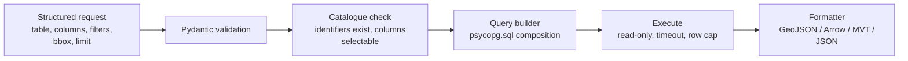

# Database Integration (PostgreSQL / PostGIS)

## 1. Principles

1. The browser talks only to the FastAPI backend. No DB credentials, DSNs, or SQL strings from the browser.
2. The browser never sends SQL. It sends **structured requests** (table reference, columns, filters as JSON). The backend builds SQL.
3. All identifiers (schema, table, column) are validated against the live catalogue before use and composed with `psycopg.sql.Identifier`. All values are bound parameters.
4. Connections use read-only roles; sessions are forced read-only with a statement timeout.

## 2. Connection management

| Aspect | Design |
|---|---|
| Storage | `app.connections` (see DATABASE_SCHEMA.md): host, port, database, username, sslmode, options; **password encrypted** with envelope encryption (Fernet/AES-GCM, key from env `APP_ENCRYPTION_KEY`, or a secret manager). Never returned by the API |
| Admin-defined connections | Alternatively declared via env/`connections.yaml` with secrets from env or Docker secrets; these are read-only in the UI. **Recommended default for MVP** (no credential entry through the browser) |
| Pooling | One `psycopg_pool.AsyncConnectionPool` per connection id, `min_size=0, max_size=5..10`, idle timeout, health check |
| Session settings | on connect: `SET default_transaction_read_only = on; SET statement_timeout = '30s'; SET idle_in_transaction_session_timeout = '30s'; SET lock_timeout='2s'` |
| TLS | `sslmode=require` or `verify-full` by default for non-localhost |
| Test | `POST /connections/{id}/test`: connect, `SELECT postgis_full_version()`, report PostGIS/h3 availability |
| SSRF guard | allow-list/deny-list for hosts (block link-local and cloud metadata addresses unless explicitly allowed); user-added connections are an admin-only capability |

## 3. Discovery

All discovery queries are catalogue queries (fast, no table scans).

**Databases**: `SELECT datname FROM pg_database WHERE NOT datistemplate AND has_database_privilege(datname,'CONNECT')`. Connections are per-database; "listing databases" shows what the role can connect to, and switching creates a sibling connection.

**Schemas** (hide `pg_*`, `information_schema`, optionally `tiger*`, `topology`):
```sql
SELECT nspname FROM pg_namespace
WHERE nspname NOT LIKE 'pg\_%' AND nspname <> 'information_schema'
  AND has_schema_privilege(nspname,'USAGE') ORDER BY 1;
```

**Tables and views** (including materialised views, partitioned parents, foreign tables):
```sql
SELECT n.nspname, c.relname, c.relkind,        -- r,v,m,p,f
       c.reltuples::bigint AS est_rows,
       obj_description(c.oid) AS comment
FROM pg_class c JOIN pg_namespace n ON n.oid=c.relnamespace
WHERE c.relkind IN ('r','v','m','p','f') AND n.nspname = %s
  AND has_table_privilege(c.oid,'SELECT');
```

**Geometry columns**: prefer the PostGIS views, and fall back to `pg_attribute` for views/materialised views that are missing from them:
```sql
SELECT f_table_schema, f_table_name, f_geometry_column, coord_dimension, srid, type
FROM geometry_columns;            -- also geography_columns
```
For views/materialised views (not listed in `geometry_columns` reliably), inspect `pg_attribute` for columns of type `geometry`/`geography` and derive type/SRID with `ST_GeometryType`/`ST_SRID` over a `LIMIT 1000` sample, or with `Find_SRID` / `typmod` decoding (`postgis_typmod_type`, `postgis_typmod_srid`). Columns with typmod 0 (unconstrained `geometry`) need the sample approach; the profile marks `geometryType: "mixed"` if the sample has more than one type.

**Profile** (`GET …/profile`) returns:
| Field | Source |
|---|---|
| schema, table, kind | catalogue |
| columns (name, type, nullable, isPrimaryKey, comment) | `information_schema.columns` / `pg_attribute` |
| geometry columns (name, type, srid, dims) | above |
| estimated row count | `reltuples` (if `-1`, never analysed: run a bounded `count` with timeout or `pg_stat`) |
| exact count (opt-in, `?exact=true`) | `SELECT count(*)` with timeout |
| extent | `ST_EstimatedExtent(schema,table,col)` (fast, from statistics; returns NULL if no stats) else `ST_Extent` with timeout; reprojected to 4326 with `ST_Transform(ST_SetSRID(ST_Extent…),4326)` |
| indexes | `pg_index` joined to `pg_class`, `pg_am` (gist/spgist/brin/btree) and `indexdef`: flag whether a **spatial index exists on the geometry column** |
| H3 candidate columns | see H3_IMPLEMENTATION.md §4 |
| primary key / feature id column | `pg_constraint` (needed for stable feature ids/picking) |
| recommended strategy | `json` / `bbox` / `mvt` / `aggregate` from est. rows (SYSTEM_ARCHITECTURE.md §7) |
| warnings | no spatial index, no PK, unknown SRID (0), mixed types, stale stats |

Table kinds without spatial indexes: the UI shows a warning with the suggested `CREATE INDEX … USING gist` (the app does not run DDL on user DBs).

**Preview**: `GET …/rows?limit=&offset=&sort=` returns attributes without geometry (or geometry as WKT truncated), `limit ≤ 1000`. Keyset pagination (`after` PK) is offered for large tables because `OFFSET` degrades.

## 4. Query architecture



**Filter grammar** (JSON, no SQL):
```json
{"op":"and","args":[
  {"column":"zone","op":"in","value":["R1","R2"]},
  {"column":"pop","op":"between","value":[1000,5000]},
  {"op":"or","args":[{"column":"name","op":"ilike","value":"%park%"}, {"column":"kind","op":"is_null"}]}
]}
```
Operators: `eq neq lt lte gt gte between in not_in like ilike is_null not_null`; spatial: `intersects` (with a GeoJSON geometry, 4326, validated and size-capped), `within_distance` (point, metres, uses `geography` or transformed geometry), `bbox`. Value types are coerced to the column type; max depth and node count limits.

**BBox/viewport query** (GiST-friendly: compare in the column's SRID by transforming the *envelope*, not the column):
```sql
SELECT id, <selected attrs>, ST_AsGeoJSON(ST_Transform(geom,4326), 6) AS g
FROM public.parcels
WHERE geom && ST_Transform(ST_MakeEnvelope(%s,%s,%s,%s,4326), 3857)   -- 3857 = table SRID
  AND <filters>
LIMIT %s;
```
Rules: never wrap the indexed column in a function in the WHERE clause (kills index use); `ST_Transform` the envelope instead. Use `&&` or `ST_Intersects` (the latter includes `&&`). Simplify by zoom with `ST_SimplifyPreserveTopology` or `ST_ReducePrecision` **on the output**. Geography columns: cast the envelope to `geography`.

**Response caps**: `limit` default 10,000, hard max configured (e.g. 100,000). When the cap is hit the response includes `"truncated": true` and the UI shows a banner offering tile mode. Never silently truncate.

**Vector tiles** (default strategy for > 100k):
```sql
WITH bounds AS (SELECT ST_TileEnvelope(%(z)s,%(x)s,%(y)s) AS geom),
mvtgeom AS (
  SELECT t.id, t.name, t.pop,
         ST_AsMVTGeom(ST_Transform(t.geom,3857), b.geom, 4096, 64, true) AS geom
  FROM public.parcels t, bounds b
  WHERE t.geom && ST_Transform(b.geom, 4326)          -- table SRID 4326
    AND <filters>
)
SELECT ST_AsMVT(mvtgeom.*, 'layer', 4096, 'geom', 'id') FROM mvtgeom;
```
- The tile endpoint is `GET /api/v1/connections/{c}/tiles/{schema}/{table}/{z}/{x}/{y}.mvt?columns=a,b&filter=<base64 JSON>`.
- Because filters/columns vary per layer, the layer's config is first registered (`POST /tiles/sessions` returns a short id) to keep URLs short and cacheable, and avoid arbitrary parameter explosion.
- Feature cap per tile and zoom-dependent simplification/dropping (`ST_Simplify` tolerance by `z`; skip tiny polygons).
- Alternative for static data: **Martin** (Rust, Apache/MIT) serving function/table sources directly with a read-only role. Recommended once layers do not need dynamic filters; evaluate in Phase 9.
- Cache: HTTP `Cache-Control`, `ETag`; optional Redis keyed by `(session, z, x, y)`; invalidate by table `pg_stat` change counter or TTL.

**Aggregation**: `GET /aggregate` supports `grid=h3|square`, `group by` category, statistics (`count,sum,avg,min,max,stddev`, quantiles via `percentile_cont`, histograms via `width_bucket`).

**Spatial analysis in SQL** (server-side by default for DB-backed layers): `ST_Buffer` (geography or projected metric SRID), `ST_Intersection`, `ST_Union` (aggregate), `ST_Clip`/`ST_Intersection` for clipping, nearest-neighbour with KNN operator `<->` and `ORDER BY geom <-> point LIMIT k`. Results are returned as GeoJSON (temporary layer); persisting results requires a writable "workspace" schema (future, explicit opt-in).

## 5. SRID handling

- The browser always speaks **EPSG:4326** (lon/lat) for inputs/outputs of the JSON API and **EPSG:3857** tile coordinates for MVT.
- The server transforms from the column SRID. SRID 0 or mismatch → warning; the user may assert an SRID in layer config (`assumedSrid`) used with `ST_SetSRID` (never silently).
- Metric operations (buffer/area/length) use `geography` or a suitable projected CRS (UTM zone from centroid; or 3857 only for rough visual work: document the area distortion).

## 6. Security

| Threat | Control |
|---|---|
| Credential leak | stored encrypted; never serialised; masked in logs; env/secret-manager for the key |
| SQL injection | no SQL from clients; identifiers verified against the catalogue then `sql.Identifier`; values bound; filter grammar whitelist; `ILIKE` patterns bound |
| Expensive queries | `statement_timeout`, row caps, bbox required above thresholds, geometry size and vertex caps on input geometries, rate limiting |
| Writes | read-only role + `default_transaction_read_only`; the app rejects non-SELECT paths by construction |
| Data leakage between users | connection-level ACL (`app.connection_grants`), checked on every request; optional PostgreSQL row-level security through per-user roles later |
| SSRF via connection host | host allow-list, admin-only creation |
| CORS | explicit origin allow-list from env, no `*` with credentials |
| AuthN/AuthZ | see API_SPECIFICATION.md §Auth: OIDC/JWT bearer, roles `viewer`, `editor`, `admin` |
| Transport | TLS at the reverse proxy; HSTS; secure cookies if cookie sessions |
| Audit | log connection id, user, endpoint, duration, row count (never values or credentials) |

Recommended DB-side role:
```sql
CREATE ROLE gis_reader LOGIN PASSWORD '…' NOINHERIT;
GRANT CONNECT ON DATABASE gis TO gis_reader;
GRANT USAGE ON SCHEMA public TO gis_reader;
GRANT SELECT ON ALL TABLES IN SCHEMA public TO gis_reader;
ALTER ROLE gis_reader SET default_transaction_read_only = on;
ALTER ROLE gis_reader SET statement_timeout = '30s';
```

## 7. Error handling

Catalogue errors map to `404 not_found`; permission errors to `403`; timeouts to `504 query_timeout` with a hint to narrow the bbox/filter; invalid filters to `422`. Messages never include raw SQL or server hostnames. See API_SPECIFICATION.md.

## 8. Endpoint summary

Full definitions are in API_SPECIFICATION.md: `/connections`, `/connections/{id}/databases|schemas|tables|…/profile|rows|features|tiles|aggregate`, `/h3/*`, `/analysis/*`, `/layers`, `/export`.
