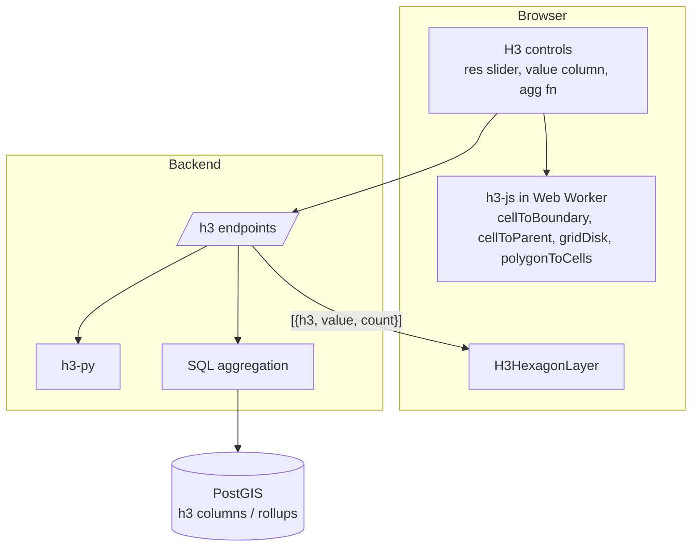

# H3 Implementation

H3 is a first-class data type. "H3 layer" always means real H3 cell indexes rendered with `H3HexagonLayer`. deck.gl's `HexagonLayer`/`GridLayer` are generic binning layers and are labelled "Hex bin (generic)" in the UI.

## 1. Architecture



Rule of thumb for placement:

| Operation | Where |
|---|---|
| Rendering cells | Browser (`H3HexagonLayer` derives geometry from the index on the GPU/CPU) |
| Parent/child, neighbours (`gridDisk`), boundary, validity, cell info | Browser (`h3-js`) |
| Aggregating a few thousand points | Browser worker (`latLngToCell`) |
| Aggregating a DB table | Server (SQL `GROUP BY`) |
| Polyfill of a polygon at high resolution | Server (`h3-py` / `polygon_to_cells`), browser only for small polygons |

## 2. Index format

- h3-js 4.x uses the lowercase 15-character hex string (`'8928308280fffff'`) and the v4 API names: `latLngToCell`, `cellToLatLng`, `cellToBoundary`, `cellToParent`, `cellToChildren`, `gridDisk`, `polygonToCells`, `cellsToMultiPolygon`, `getResolution`, `isValidCell`, `isPentagon`, `cellArea`. (The v3 names `geoToH3`, `h3ToParent`, `polyfill` do not exist in v4: do not use them.) Installed: 4.5.0.
- In PostgreSQL store either:
  - `h3_index h3index` (PostgreSQL `h3` extension, `h3-pg`), or
  - `h3_index bigint` (64-bit integer; most compact, fast join and index) and convert to hex at the API edge, or
  - `h3_index text` (hex string; simplest, interoperable with h3-js and deck.gl directly).
- **Decision:** the API always emits **hex strings**. Detection supports all three storage forms. Recommended storage for new tables: `bigint` + a generated resolution column (see §3). Note: JavaScript numbers cannot represent a 64-bit value precisely; never send H3 `bigint` as JSON numbers. Convert with `to_hex(h3_index)` in SQL or `h3.int_to_str` in Python.

## 3. Database schema

```sql
-- Plain H3 data table (no extension required)
CREATE TABLE h3_population (
  h3_index    bigint  NOT NULL,
  resolution  smallint NOT NULL,
  population  integer,
  income      numeric,
  area        double precision,
  category    text,
  PRIMARY KEY (resolution, h3_index)
) PARTITION BY LIST (resolution);

-- Optional per-resolution partitions (9, 10, ...). Index on h3_index implicit through the PK.
CREATE INDEX ON h3_population (h3_index);

-- Rollup for fast zoom changes
CREATE MATERIALIZED VIEW h3_population_r7 AS
SELECT h3_cell_to_parent(h3_index::h3index, 7)::bigint AS h3_index, 7::smallint AS resolution,
       sum(population) AS population, avg(income) AS income, count(*) AS n
FROM h3_population WHERE resolution = 9 GROUP BY 1;
```

Viewport query without the `h3` extension: precompute and store the cell's centre (or a coarse parent cell at e.g. resolution 4, `h3_parent_4`) as an indexed column, then filter by the set of parent cells covering the viewport (computed with `polygonToCells` of the bbox). The bbox → parent set approach is index-friendly and works with plain PostgreSQL. With `h3-pg` the equivalent is `h3_polygon_to_cells`, and `h3_cell_to_geometry` allows a GiST index on cell geometry.

Geometry table + H3 enrichment (generating H3 from points):

```sql
ALTER TABLE poi ADD COLUMN h3_9 bigint
  GENERATED ALWAYS AS (h3_latlng_to_cell(geom::point, 9)::bigint) STORED;  -- requires h3-pg
CREATE INDEX ON poi (h3_9);
```
Without `h3-pg`, compute in the backend/ETL using h3-py and `UPDATE`. (Note the app itself uses a read-only role; enrichment is a separate ETL step or a future admin feature.)

## 4. H3 column discovery

A column is an **H3 candidate** if any of:
1. Type is `h3index` (extension).
2. Name matches `^(h3|h3_?index|hex(id)?|cell(_?id)?|h3_\d{1,2})$` (case-insensitive) and type is `text`/`varchar`/`bigint`.
3. Sample test: take up to 100 non-null values; at least 95% pass validity (`h3.is_valid_cell` in the backend; text: `^[0-9a-f]{15}$`; bigint: top bits check by conversion then `is_valid_cell`).

Result: `{column, storage: 'h3index'|'bigint'|'text', resolutions: [min..max found], resolutionColumn?: string, confidence}`. Resolution is obtained with h3-py `get_resolution` on the sampled values (or `h3_get_resolution` with `h3-pg`); do not parse it from the hex string by hand.

## 5. Resolution management

- Resolution 0-15 selector (slider with the average edge length / cell area shown from `h3.average_hexagon_edge_length` / `cell_area`).
- **Auto mode** maps zoom to resolution so cells stay roughly 30-60 px wide. Starting heuristic (derived from h3-js 4.5 average edge lengths, e.g. res 5 = 9.85 km, res 6 = 3.73 km, res 9 = 0.20 km, and Web Mercator ground resolution at the equator, ~153 m/px at zoom 10; **calibrate in task H3-03**, latitude changes the ground resolution by cos(lat)):

  `res = clamp(round(zoom - 4.5), 0, 15)`

  | Map zoom | ≤5 | 6 | 7 | 8 | 9 | 10 | 11 | 12 | 13 | 14 | 15 | 16 | 17 | 18+ |
  |---|---|---|---|---|---|---|---|---|---|---|---|---|---|---|
  | H3 res | 0-1 | 2 | 3 | 4 | 5 | 6 | 7 | 8 | 9 | 10 | 11 | 12 | 13 | 14-15 |
- **Fixed mode**: user fixes a resolution; if the source data is finer than requested, aggregate to the parent; if coarser, show native resolution and warn (never invent children).
- **Resolution transitions**: when the target resolution changes, keep the old layer visible until the new data arrives (deck.gl layer ids differ, cross-fade with `opacity` via a transition, or just swap). Cache per `(layer, resolution, tile)`.
- Hard cap: refuse to request more than `max_cells` (default 250,000) for one viewport; the API returns the coarser resolution it chose (`X-H3-Resolution` / body `resolution`) so the UI can show "showing res 8".

## 6. H3HexagonLayer implementation

```jsx
new H3HexagonLayer({
  id: layer.id,
  data,                                  // [{ h3: '8928308280fffff', value: 123, n: 5 }, …]
  getHexagon: d => d.h3,
  getFillColor: d => colorScale(d.value),   // from the styling engine
  getElevation: d => d.value,
  extruded: style.extrusion.enabled,
  elevationScale: style.extrusion.scale,
  filled: true, stroked: true,
  getLineColor: [255, 255, 255, 80],
  lineWidthMinPixels: 1,
  coverage: 0.95,
  highPrecision: 'auto',
  pickable: true, autoHighlight: true,
  opacity: layer.opacity,
  updateTriggers: { getFillColor: [style.fill], getElevation: [style.extrusion] },
})
```

Notes:
- Pass data as plain arrays; for >~200k cells prefer a columnar/binary form with accessor offsets or aggregate more coarsely.
- `updateTriggers` must include every style input or colours go stale after style edits.
- Mixed-resolution cells are allowed but 3D extrusion with mixed resolution looks inconsistent.
- Pentagons are handled by the layer; `highPrecision` avoids slight offsets.

## 7. Aggregation

API-level contract (see API_SPECIFICATION.md `GET /h3/aggregate`): inputs `source`, `resolution`, `bbox`, `value`, `agg ∈ {count,sum,avg,min,max,median}`, filters. Output rows `{h3, value, count}`.

Three source modes:
1. **Points table → H3**: `GROUP BY h3` using an existing column (best), else computing it in SQL (`h3-pg`) or in Python (h3-py) on a bbox-filtered result (limit enforced; fall back to sampling or coarser resolution).
2. **Polygons → H3**: polyfill with `polygon_to_cells` (centroid containment), optionally area-weighted apportionment (document: simple is count of containing polygon centroid; areal interpolation is Later).
3. **H3 table → coarser H3**: `cell_to_parent` then aggregate (sum for extensive variables like population; avg weighted for intensive variables like income; the UI asks the user which kind the column is, default `sum` for names containing pop/count and `avg` otherwise).

Statistics: per-viewport min/max/mean/quantiles returned alongside cells so the legend can use stable class breaks.

## 8. Querying

Viewport request: compute covering parents in the browser (`polygonToCells(bboxPolygon, parentRes)`), or let the backend do it. The backend verifies the number of parents is ≤ a limit (e.g. 5,000).

Filtering: `WHERE h3 = ANY(:cells)` or `h3_parent IN (...)`, plus attribute filters via the shared query builder.

Spatial selection: polygon from user → server `polygon_to_cells` at the layer resolution → `JOIN` with the data table.

## 9. Interaction

| Feature | Implementation |
|---|---|
| Hover | `autoHighlight`, tooltip: index, resolution, value |
| Click select / shift multi-select | `selectionStore` set of `{layerId, h3}`; render selection with an extra outlined `H3HexagonLayer` |
| Inspector | index, resolution, base cell, pentagon?, centre lat/lng, area (`cellArea`), all row attributes, parent (res-1…0), children count |
| Parent / children | `cellToParent` / `cellToChildren` (children count 7^Δ: refuse Δ>4 in the browser without confirmation) |
| Neighbours | `gridDisk(cell, k)` |
| Box/polygon select | draw tool → `polygonToCells` at the layer resolution (workers for large) |
| Export | selected / filtered cells to CSV (index, value), GeoJSON (via `cellToBoundary` with `geoJson=true`, check the argument order: GeoJSON wants lng/lat), and optionally Parquet later |
| Resolution transition | see §5 |

## 10. Performance

- Server aggregation first; never ship raw points just to bin them above ~1M points.
- Adaptive resolution from zoom keeps the visible cell count bounded (target ≤ 50k cells in view).
- Cache responses by `(source, filters-hash, resolution, parentCellOrTile)`; precompute rollups per resolution for 10M+ datasets (materialised views, Redis).
- Web Worker for `h3-js` heavy ops (polyfill, `cellsToMultiPolygon`, bulk `cellToParent`).
- Avoid creating new data arrays on every render; memoise on `(data, style)`.
- Use `ArrayBuffer`/Arrow responses for very large cell sets; JSON with short keys otherwise.
- Aggregate as `bigint` in the DB; convert to hex once.

## 11. Correctness risks and tests

See TESTING_STRATEGY.md §H3: round-trip tests (`latLngToCell` ↔ `cellToLatLng`), known-vector tests (San Francisco `37.7749, -122.4194` at resolution 9 is `89283082803ffff`, verified against h3-js 4.5.0 on 2026-11-09), pentagon handling, antimeridian-crossing cells, parent/child consistency, and server/client parity between h3-py and h3-js.
