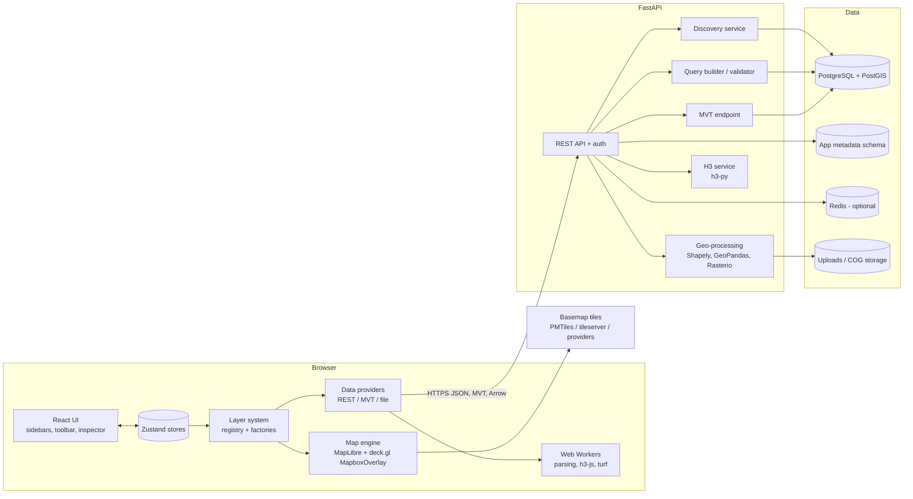
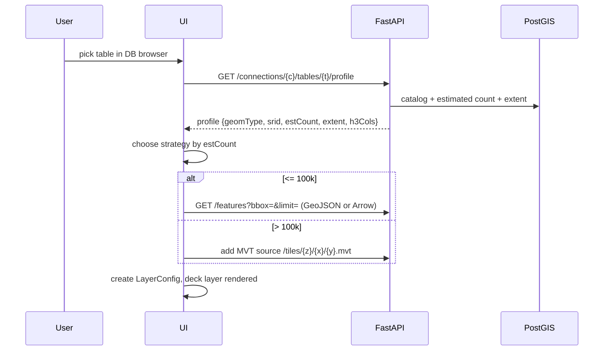

# System Architecture

## 1. Explicit architectural decisions

| # | Decision | Rationale |
|---|---|---|
| AD-1 | **MapLibre GL JS** is the base map renderer; Mapbox GL is not used | BSD-licensed, no token or billing; already installed |
| AD-2 | **deck.gl** renders all data layers | GPU rendering, binary attributes, tiled layers |
| AD-3 | Real **Uber H3** indexes via `H3HexagonLayer` + `h3-js` (browser) + `h3-py` or the PostGIS `h3` extension (server). deck.gl's `HexagonLayer`/`GridLayer` are generic aggregations and are never labelled "H3" | Avoids the common confusion |
| AD-4 | **PostgreSQL + PostGIS** is the primary spatial store | Mature, indexed, SQL |
| AD-5 | **Python + FastAPI** is the geospatial backend | GeoPandas/Shapely/Rasterio/GDAL ecosystem; async; OpenAPI generated |
| AD-6 | **All database access is backend-only**; credentials never reach the browser | Security |
| AD-7 | Separation: *map engine*, *layer system*, *data providers*, *UI* are separate modules with one-way dependencies | Extensibility |
| AD-8 | Layer types are **plugins** registered in a registry; adding one never edits the map component | Extensibility |
| AD-9 | Docker Compose for deployment; Linux containers; WSL2 for dev | |
| AD-10 | Interleaved vs overlaid deck.gl: start with **`MapboxOverlay` (overlaid, `interleaved: false`)** via `react-map-gl/maplibre` `useControl`; switch to interleaved only if layer-under-labels ordering is required (see risks) | Overlaid is simpler and most robust; interleaved gives label ordering |
| AD-11 | Start in **JavaScript with JSDoc types**; plan migration to TypeScript at the end of Phase 1 if the team agrees (Open question Q1) | Existing project is JS |
| AD-12 | Zustand for state (not Redux Toolkit) | Small, selector-based, easy to use outside React (map engine) |

## 2. High-level architecture



## 3. Frontend architecture

### 3.1 Module layout (proposed)

```
src/
  app/            App shell, routing, providers
  map/            MapView (react-map-gl/maplibre + DeckOverlay), viewState sync, basemaps
  layers/
    registry.js   registerLayerType(); getLayerType()
    types/        one folder per layer type: vector/, h3/, heatmap/, mvt/, ...
                  each exports { id, schema, defaults, createDeckLayer, legend, inspector }
    LayerFactory  config -> deck.gl Layer instances
  data/
    providers/    restFeatures, mvt, geojsonFile, csvFile, flatgeobuf, wms, cog
    cache/        request cache, AbortController management
    workers/      parsing + h3 + turf workers
  styling/        color ramps, scales (d3-scale), classification, legend generation
  tools/          draw, select, measure, analysis (each a tool plugin)
  state/          zustand stores: layers, map, selection, ui, connections
  ui/             components: sidebars, toolbar, statusbar, inspector, primitives
  api/            typed client for the FastAPI backend
```

Dependency rule: `ui -> state -> layers -> data/styling`; `map` depends on `layers` output only. `layers` never imports `ui`. Data providers never import deck.gl.

### 3.2 Layer plugin contract

```js
/** @typedef {Object} LayerType
 * @property {string} id                       // 'h3', 'vector', 'heatmap'
 * @property {string[]} sourceKinds            // data source kinds it accepts
 * @property {object} configSchema             // JSON Schema for validation + auto-generated styling panel
 * @property {() => object} defaults
 * @property {(cfg, data, ctx) => import('deck.gl').Layer[]} createDeckLayers
 * @property {(cfg, data) => LegendSpec} legend
 * @property {(info) => InspectorModel} inspect // pick info -> inspector panel
 */
```

A layer *instance* is serialisable JSON (`LayerConfig`, see DATABASE_SCHEMA.md): `{id, name, type, sourceRef, visible, opacity, order, style, filters}`. deck.gl layer objects are derived and never stored.

### 3.3 State

| Store | Contents | Persistence |
|---|---|---|
| `layersStore` | ordered LayerConfig[], active layer | saved to backend on demand, localStorage draft |
| `mapStore` | viewState, basemap, pitch/bearing, cursor coords | URL hash (partial) |
| `selectionStore` | selected features/cells, hover | memory |
| `connectionsStore` | connection list (metadata only, no secrets), discovered catalog | server |
| `uiStore` | panel state, active tool | localStorage |

Rendering-hot state (hover, viewState) lives in refs or its own store to avoid re-rendering the whole tree. Use selectors.

### 3.4 Map engine

- `<Map>` from `react-map-gl/maplibre` with `mapLib={import('maplibre-gl')}`.
- A `DeckGLOverlay` component uses `useControl(() => new MapboxOverlay({interleaved, layers}))` from `@deck.gl/mapbox` (exported by the `deck.gl` umbrella as `MapboxOverlay`; the `@deck.gl/maplibre` package is present too; confirm which export to use when implementing and keep one).
- Layer order = array order from the layers store; `id`s stable to keep deck.gl diffing efficient.
- Tooltips/picking: `getTooltip` and `onClick` routed into `selectionStore`.
- The basemap is a MapLibre style URL or inline style object chosen from the basemap registry.

## 4. Backend architecture

```
backend/
  app/
    main.py                FastAPI app, CORS, middleware
    config.py              pydantic-settings, env vars
    auth/                  JWT, OIDC adapter, RBAC
    api/v1/                routers: connections, catalog, tables, features, tiles, h3, analysis, layers, export
    services/
      connections.py       encrypted credential store, pool manager
      discovery.py         catalog queries
      query_builder.py     safe SQL composition (psycopg.sql)
      tiles.py             ST_AsMVT
      h3_service.py
      geoprocessing.py     Shapely/GeoPandas ops
      raster.py            Rasterio/GDAL
    db/                    psycopg3 async pools, app metadata models (SQLAlchemy + Alembic)
    schemas/               pydantic models
  tests/
```

- **Driver**: `psycopg` 3 with `psycopg_pool.AsyncConnectionPool`; SQLAlchemy only for the app metadata schema.
- **Pools**: one pool per saved connection, lazily created, size-limited, idle-evicted.
- **Workers**: heavy GeoPandas/Rasterio jobs run in a process pool or task queue (arq/RQ, Phase 9); API returns a job id.
- **Validation**: Pydantic for every request; identifiers are never interpolated, only composed with `psycopg.sql.Identifier` after being verified against the live catalog.

## 5. Database architecture

Two logically separate concerns:

1. **Application metadata DB** (`app` schema): users, connections, saved layers, projects, settings. Owned by the app; see DATABASE_SCHEMA.md.
2. **User data DBs**: any PostGIS database the user connects to. Accessed with a **read-only role** by default. The app never writes to them except in explicit future "write-back" features (out of MVP).

## 6. Data flow

### 6.1 Load a PostGIS table (size-adaptive)



### 6.2 H3 flow

`profile` finds an H3 column -> user picks resolution/value column -> UI requests `/h3/cells?bbox&res&value=...` (server aggregates to the viewport + resolution) -> `H3HexagonLayer` with `getHexagon: d => d.h3`. See H3_IMPLEMENTATION.md.

## 7. Scale strategy

| Size | Strategy |
|---|---|
| ~10k features | One GeoJSON/Arrow request, full client rendering, client-side filtering/styling, Turf for tools |
| ~100k | Viewport (bbox) queries with `ST_Intersects` + GiST index, debounce on move end, optional simplification; GeoJSON compressed (gzip/br) or Arrow. Client-side styling still OK. Binary-attribute path preferred |
| ~1M | **MVT** via `ST_AsMVT` (or Martin/pg_tileserv) with `deck.gl MVTLayer`; attribute styling on the client from tile properties; per-zoom simplification and feature dropping; H3 data: server-side aggregation to viewport at an adaptive resolution |
| 10M+ | Pre-aggregated: materialised H3 rollups per resolution (and/or pre-generated tiles / PMTiles), tile-level caching (Redis/CDN), partitioned tables, `ST_Subdivide`, BRIN/GiST, zoom-dependent tables (point-thinning), statistics via sampled `TABLESAMPLE` or pre-computed. Never show raw features below a threshold zoom |

Thresholds are defaults, configurable, and chosen from the `estimated count` (`pg_class.reltuples`) in the table profile.

## 8. Technology choices and licenses

| Component | Choice | License |
|---|---|---|
| UI | React 19, Vite 8 | MIT |
| Styling | Tailwind CSS (+ Radix UI primitives / shadcn-style components) | MIT |
| State | Zustand | MIT |
| Map | maplibre-gl, react-map-gl | BSD-3, MIT |
| Viz | deck.gl 9.x | MIT |
| H3 | h3-js; h3-py; optional PostgreSQL `h3-pg` extension | Apache-2.0 |
| Browser spatial | Turf.js | MIT |
| Colors / scales | d3-scale, d3-scale-chromatic, d3-array | ISC / BSD-3 |
| Draw / edit | `@deck.gl-community/editable-layers` (nebula.gl successor) or Terra Draw | MIT |
| File parsers | loaders.gl (already a transitive dep), flatgeobuf, papaparse | MIT / BSD |
| COG | `geotiff.js` (+ a deck.gl integration, e.g. `@developmentseed/deck.gl-geotiff`) | MIT |
| Basemap hosting | PMTiles / Protomaps, OpenMapTiles + tileserver-gl or Martin, OpenStreetMap data (ODbL, attribution required) | BSD / ODbL |
| Backend | FastAPI, Pydantic, Uvicorn, psycopg3, SQLAlchemy, Alembic | MIT / BSD / LGPL (psycopg; dynamic link, acceptable) |
| Geo (Python) | Shapely, GeoPandas, pyproj, Rasterio, GDAL, h3-py, pyogrio | BSD / MIT / Apache |
| DB | PostgreSQL, PostGIS (GPL-2+, used as a separate server, not linked) | PostgreSQL / GPL |
| Tile server (optional) | Martin | Apache-2.0/MIT |
| Infra | Docker, Compose, Nginx/Caddy, Redis (BSD-3 up to 7.2; consider Valkey) | |

**License review task** is in the roadmap (P1): run `license-checker` and `pip-licenses` in CI and fail on non-permissive licenses outside an allow-list. Note: proprietary basemaps (Google, Mapbox, Bing, ESRI) are excluded; Satellite imagery needs a free/open source (e.g. Sentinel-2 cloudless, NASA GIBS, OpenAerialMap) or a user-supplied key; confirm provider ToS before shipping defaults.

## 9. Basemaps

Basemap registry entry: `{id, label, kind: 'style'|'raster', url, attribution, minzoom, maxzoom, requiresKey}`.

| Basemap | Open option |
|---|---|
| Light / Dark / Streets | Self-hosted OpenMapTiles/Protomaps style (Positron / Dark Matter / OSM Liberty styles are open); or hosted tile providers with permissive ToS |
| Satellite | Sentinel-2 cloudless (EOX, CC BY-NC for the free layer: check licensing), NASA GIBS, or user-provided XYZ |
| Terrain | Terrarium/Mapbox-RGB-style DEM tiles (AWS Terrain Tiles, open) + MapLibre `raster-dem` hillshade / 3D terrain, or deck.gl `TerrainLayer` |
| Topographic | OpenTopoMap (CC-BY-SA, check usage policy) or self-hosted contours + hillshade |
| Blank | Style with only a background colour |

Public OSM tile servers must not be used for production traffic: self-host (PMTiles on object storage or tileserver-gl) for deployment.

## 10. Risks

| Risk | Mitigation |
|---|---|
| Newer major versions (vite 8, maplibre-gl 6, eslint 10) vs. docs | Pin; smoke-test deck.gl + react-map-gl on Phase 2 first task |
| Overlaid deck.gl draws above basemap labels | Interleaved mode with `beforeId`, or a separate label layer |
| COG layer immaturity | Server-side raster tiling via Rasterio/titiler as fallback |
| `h3` PostGIS extension availability | H3 computed in Python/ingest, stored as `bigint`/`text`; extension optional |
| Large GeoJSON memory | Arrow/binary, MVT, workers |

## 11. Implementation notes and architectural changes (Phases 1-2)

Changes relative to the design above, made while implementing the first two phases.

| Area | Design | Implemented | Reason |
|---|---|---|---|
| deck.gl overlay | `MapboxOverlay` (`@deck.gl/mapbox`) | `MapLibreOverlay` from `@deck.gl/maplibre`, `interleaved: false` | `MapboxOverlay` is not exported by the `deck.gl` umbrella package in 9.4.1 and `@deck.gl/maplibre` is the MapLibre-specific overlay. Resolves AD-10 / open question Q10 for now. |
| Explicit dependencies | umbrella only | `@deck.gl/maplibre` and `@deck.gl/aggregation-layers` added explicitly | Heatmap/Hexagon layers and the overlay were only transitive; layers are imported from the sub-packages that own them. |
| MapLibre worker | not covered | `map/maplibreSetup.js` registers `maplibre-gl-worker.mjs` via Vite `?url` and `setWorkerUrl()` | maplibre-gl 6 locates its worker relative to its own module URL, which is wrong once Vite pre-bundles or chunks the library (error "Worker failed to load", basemap silently falls back). Verified in dev and production builds. |
| UI primitives | Radix UI + shadcn-style | small hand-written components in `ui/` | Avoids adding dependencies before they are needed; Radix remains the plan for Dialog/Popover/Tree. |
| Layer reordering | drag and drop (dnd-kit) | move up / move down buttons | Keyboard accessible, no dependency; DnD is a later enhancement. |
| Routing | "if required" | none | Single-screen workspace; add a router when a second page exists. |
| LineLayer | "LineLayer" | deck.gl `PathLayer` | deck.gl's `LineLayer` only draws two-point segments; GIS polylines need `PathLayer`. The layer type id is still `line`. |
| H3 aggregation | server or worker | main thread (`h3/h3Utils.js`) | Sample data is 20k points; moving it to a worker is task P5-01/P9-03. Aggregated data is memoised per (layer, resolution). |
| Basemaps | self-hosted | CARTO Positron / Dark Matter public styles (OpenStreetMap data) + Blank, overridable by env | Fast to start. Review CARTO's terms before production use; self-hosting remains task P2-06. If a style fails to load the map falls back to Blank and shows a toast. |
| Testing | Vitest + Playwright | Vitest (+ Testing Library, jsdom) and `playwright-core` driving the system Chrome/Chromium (`npm run test:e2e`) | No browser download is needed; `@playwright/test` can replace the script later. |

### Backend deviations (Phase 6A)

| Area | Design | Implemented | Reason |
|---|---|---|---|
| Tiles | `GET /connections/{c}/tiles/{schema}/{table}/{z}/{x}/{y}.mvt` (DATABASE_INTEGRATION section 4) | Sessions: `POST /connections/{id}/tiles/sessions`, `GET /tiles/{sessionId}/{z}/{x}/{y}.mvt`, `/tilejson`, `DELETE` | API_SPECIFICATION is the source of truth. Sessions are in memory (TTL 8 h), owned by the creating user (admin may read) and not shared across processes. |
| Connections | admin-managed CRUD, encrypted user connections, grants | `connections.yaml` (read-only, secrets from env, optional `allowed_users`) plus admin CRUD (`POST`/`PATCH`/`DELETE /connections`) stored in `app.connections` with Fernet-encrypted passwords (`H3MAP_ENCRYPTION_KEY`, `H3MAP_APP_DATABASE_URL`; both required, else 501). Grants: `GET/PUT /connections/{id}/grants` keyed by token `sub` (`app.connection_grants.subject`, migration 0002); no grants = open to every authenticated user, admins always allowed. Checked by a router dependency and again on tile fetches | Connection ids of user connections are UUIDs; env ids are slugs. Env connections are read-only (409). The built-in login has no `app.users` rows, so grants use the JWT subject. |
| Auth | OIDC-ready JWT | HS256 JWT, single admin from env; other roles only via tokens | Minimum viable P6-01. |
| Features | `limit` / `after`, Arrow | Ordered keyset paging only with `paginate=true` or `after`. `format=arrow` returns an Arrow IPC stream: attribute columns, `__fid`, `__geometry` (WKB, EPSG:4326), paging info in schema metadata | Avoids an ORDER BY on large bbox queries. H3 endpoints stay JSON. |
| H3 | h3-pg or h3-py | SQL roll-ups use the bigint bit layout (no extension needed); point binning uses h3-pg when installed (`H3MAP_H3_SQL=auto`), else h3-py on a bbox-limited scan (`max_h3_scan_rows`). `/h3/cells/export` not implemented | Works on databases without the h3 extension; export is out of scope. |
| Catalogue | hide system objects | Objects owned by an extension (`pg_depend` type `e`: PostGIS views, `spatial_ref_sys`, ...) are hidden from schema and table lists; they stay readable by name | Keeps the browser free of extension internals. |
| Windows | n/a | `app/__init__.py` selects the selector event loop; run uvicorn with `--loop none` | psycopg async cannot use the Proactor loop. |
| Docker | `docker-compose.yml` with postgis | Not provided in Phase 6A | The project owner runs PostgreSQL themselves. |

### Layer pipeline as built

```
LayerConfig (JSON, in layersStore) ─┐
DataSource.load() -> GeoJSON ───────┼─> layerType.prepare()  (memoised in buildDeckLayers by prepareKey)
autoResolution (from zoom) ─────────┘          │
                                               └─> layerType.createDeckLayers() -> deck.gl Layer[]
                                                          │
 map/useDeckLayers.js (only bridge between stores and layers) ─> <DeckOverlay> ─> MapLibreOverlay
```

- `data/sources.js` is the data-source registry. A PostGIS table will be another source kind whose `load()` calls the backend; layer types depend only on GeoJSON and the source's `fields`, so no layer code changes.
- Layer-type contract additions: `controls` (schema for the generated style panel, with `showIf`), `describe()` (tooltip and inspector content), `legend()`, `info()` (runtime facts such as the effective H3 resolution).
- H3 selection is part of the render context; a selected cell is cleared when the layer's resolution changes.
