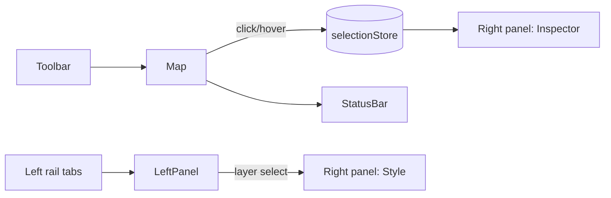
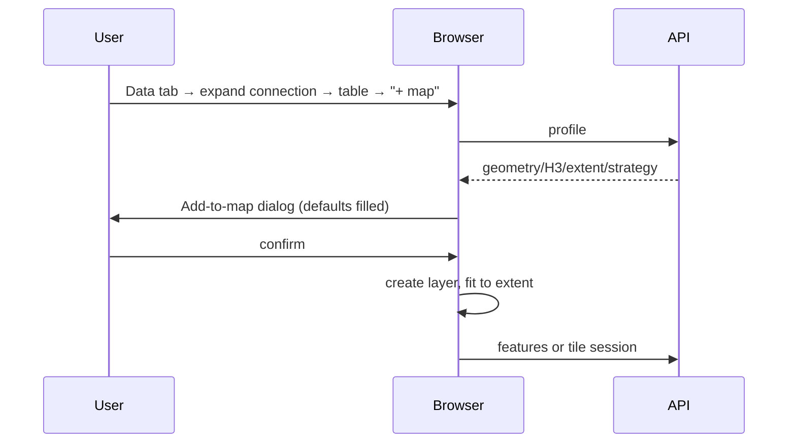

# UI / UX Design

Goal: a focused, map-first GIS workspace (QGIS rigour, Kepler.gl/CARTO polish), not a generic admin dashboard. The map is the product; chrome is thin, dense, and collapsible.

## 1. Layout

```
┌──────────────────────────────────────────────────────────────────────────────┐
│ ▣ Logo  [🔍 Search place / H3 / coord]  Basemap▾  +Data  +Layer  ✎Draw ⟷Measure ⇩Export ⚙ │ Top toolbar (48px)
├────────┬───────────────────────────────────────────────────────────┬─────────┤
│ LEFT   │                                                           │ RIGHT   │
│ rail   │                    MAP (full bleed)                       │ panel   │
│ ▤ Layers│   floating: zoom/rotate/pitch, scale, legend (bottom-left)│ Inspector│
│ ⛁ Data  │                                                           │ Style   │
│ ⬡ H3    │                                                           │ H3 info │
│ ⚒ Tools │                                                           │         │
├────────┴───────────────────────────────────────────────────────────┴─────────┤
│ lon, lat │ zoom 11.4 │ 1:50,000 │ EPSG:4326 │ 3 selected │ H3 res 7 │ status  │ Status bar (28px)
└──────────────────────────────────────────────────────────────────────────────┘
```

- The map fills the viewport (`position:absolute; inset:0`). Sidebars **overlay** it as floating panels (glass/solid cards with 8px radius) so the map is never resized (avoids WebGL canvas resize churn); each sidebar is collapsible (shortcut `[` / `]`) and resizable (260-480px).
- Responsive: ≥1280px both sidebars; 768-1279 the right panel becomes a slide-over; <768 bottom sheet with tabs (Layers / Data / Inspect), toolbar collapses into a menu. Touch gestures supported by MapLibre/deck.gl.
- Dark and light UI themes (follows the OS; independent of the basemap).



## 2. Left sidebar (tabbed rail)

1. **Layers**: sortable list (drag handle, eye toggle, name, type icon, opacity slider on expand, kebab menu: rename, duplicate, zoom to, metadata, remove). Group support later. Empty state with "Add data".
2. **Data**: sources list (database connections tree, files, services) and **Database browser** (§5).
3. **H3**: H3 controls (§6) for the active layer, plus the "Generate H3 from layer" wizard.
4. **Tools**: select, draw, measure, analysis (buffer, intersect, union, clip, nearest) with parameter forms and a results list.

## 3. Top toolbar

| Control | Behaviour |
|---|---|
| Search | geocoding (self-hosted Nominatim/Photon, configurable; optional), coordinate parsing (`lat, lon`), H3 index parsing (pasted `89…` zooms to the cell), layer/feature attribute search |
| Basemap selector | popover with thumbnails (Light, Dark, Streets, Satellite, Terrain, Topo, Blank) |
| Add data | dialog: Database / File / URL (XYZ, WMS, MVT, COG) tabs |
| Add layer | pick layer type then source; wizard-less when launched from a table ("Add to map") |
| Draw | point / line / polygon / rectangle / circle; finish with Enter/double-click, cancel Esc |
| Measure | distance / area with live labels; units km/m/mi/ha |
| Export | selection or layer → GeoJSON/CSV/…; map image (PNG) |
| Settings | theme, units, coordinate format, performance limits, basemap config |

## 4. Layer manager and styling panel

Layer row anatomy: `⋮⋮ ◉ ▢ Name ........ [type icon] ⋯`. Selecting a layer opens **Style** in the right panel with sections generated from the layer type's `configSchema`:

- **Fill**: mode (Single / Categorical / Numeric graduated), column select (typed, with numeric/text icons), ramp picker with preview, classes + method (equal interval, quantile, natural breaks, manual), reverse, null colour, opacity.
- **Stroke**: colour, width (+units), dash.
- **Point**: radius fixed or by column (min/max range), icon.
- **Extrusion** (polygons/H3): toggle, height column, scale, wireframe.
- **Filters**: rule builder (column, operator, value) with AND/OR; spatial filter from drawn shape; live count.
- **Labels**: column, size, halo.
- **Legend**: auto-generated, editable labels, title, position.
- **Metadata** tab: source, SRID, geometry type, feature count, extent, indexes, strategy in use (GeoJSON/Tiles/Aggregated) with a "why" tooltip.
Controls apply with ≤100 ms latency for client-styled layers (debounced requests for server-aggregated ones, with a subtle loading bar in the layer row).

## 5. Database browser

```
⛁ Connections
 ▾ prod-gis  ● connected      [⟳] [⚙]
   ▾ public
      ▦ parcels      MultiPolygon · 4326 · ~1.25M     [+ map]
      ● poi          Point        · 4326 · ~84k       [+ map]
      ⬡ h3_population  H3 (res 9) · 220k              [+ map]
      ▤ lookup_codes  (no geometry)
   ▸ analytics
```
- Icons by type (polygon/line/point/H3/raster/non-spatial); filter box and "geo only" toggle; context menu: Preview rows, Table metadata, Add to map, Copy name.
- **Table detail drawer**: tabs Overview (counts, extent mini-map, warnings such as "no spatial index"), Columns, Indexes, Preview (paginated grid, virtualised), H3.
- **Add to map dialog**: pre-selected geometry column or H3 column, layer type suggestion, attribute columns to fetch (default: none/PK + style column), initial filter, strategy shown (auto).
- Errors are shown inline with a retry; credentials never displayed.

## 6. H3 controls

- Resolution: auto/fixed toggle, 0-15 slider with live "avg edge ≈ 1.4 km, cell area ≈ 5 km²".
- Source mode: existing H3 column | aggregate from points | polyfill polygons.
- Value: column, aggregation (count/sum/avg/min/max/median).
- Colour: ramp + classes; 3D toggle and height scale.
- Overlays: show parent (res-n) outline, show children, neighbours (k-ring).
- Selection tools: click, shift-multi, draw polygon select → "N cells selected" chip.
- Actions: export cells, copy indexes, filter to selection, zoom to selection.
- Readout when auto: "Showing res 8 (zoom 12.6)".

## 7. Feature inspector (right panel)

Header: layer name + feature id; Tabs **Attributes** (searchable key/value table, copy value, link/URL detection), **Geometry** (type, vertices, area/length, centroid, bbox), **H3** (for features or cells: index, resolution, parent chain, children count, neighbours, area), **Raw** (JSON). Multiple selection shows a list plus aggregate stats (count, sum/mean of numeric columns). Attributes for tile-based layers are fetched on demand by id.

## 8. Design system

| Aspect | Spec |
|---|---|
| Stack | Tailwind CSS + Radix UI primitives (headless; MIT) + Lucide icons (ISC), shadcn/ui-style component copies |
| Type | Inter (UI), JetBrains Mono (coordinates, indexes, SQL-like), 12-13px base for density |
| Colour | neutral slate palette, one accent (teal/blue), semantic success/warn/danger; map overlay colours independent of UI colours; categorical palettes colour-blind safe (ColorBrewer/Okabe-Ito), sequential ramps perceptual (viridis, cividis, YlGnBu, etc.) |
| Spacing | 4px grid; panel padding 12px; row height 32px |
| Elevation | 1px borders + soft shadow for floating panels; no heavy gradients |
| Motion | 120-200ms ease-out; respects `prefers-reduced-motion` |
| Accessibility | WCAG 2.1 AA contrast, full keyboard operation, focus rings, ARIA for tree/list/dialog, tooltips not the sole carrier of information |
| Density | compact by default; "comfortable" option |
| Tokens | CSS variables (`--bg`, `--panel`, `--border`, `--accent`, …) so themes and embedding are simple |

The existing `src/index.css` and `App.css` are Vite template styles and will be removed in Phase 1.

## 9. Interaction flows

**Add a PostGIS table**


**Colour H3 by population**: Layers → select H3 layer → Style → Fill = Numeric → column `population` → ramp viridis → quantile 7 classes → legend appears bottom-left; hover tooltip shows index + population.

**Spatial filter**: Tools → Draw polygon → "Filter layer by shape" → layer re-queries (server) → filter chip on the layer row (click to clear).

**Inspect**: click feature → right panel opens on Attributes; click empty map → closes (or keep pinned).

## 10. Keyboard shortcuts

`V` select, `P` point, `L` line, `G` polygon, `M` measure, `Esc` cancel, `Del` remove selected drawing, `[`/`]` toggle sidebars, `/` focus search, `Ctrl+Z` undo drawing edits, `?` shortcuts list.

## 11. Empty, loading, and error states

Skeletons for lists; map-level progress bar for tile/feature loading; banners for `truncated` results ("Showing first 10,000 features. Switch to tiles / zoom in"); inline retry for failed requests; layer row shows a warning icon with a tooltip for layer errors.
